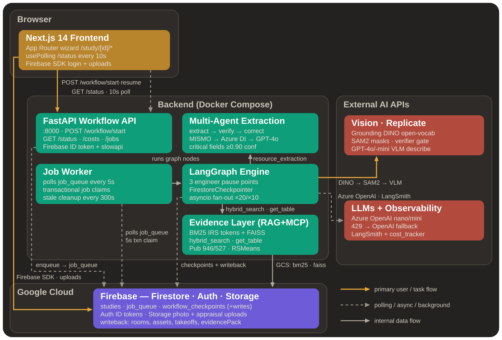
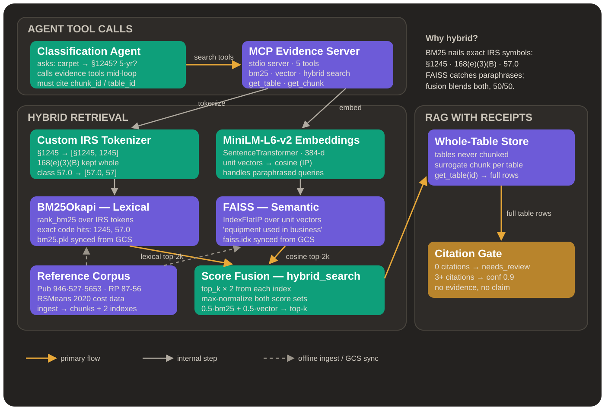
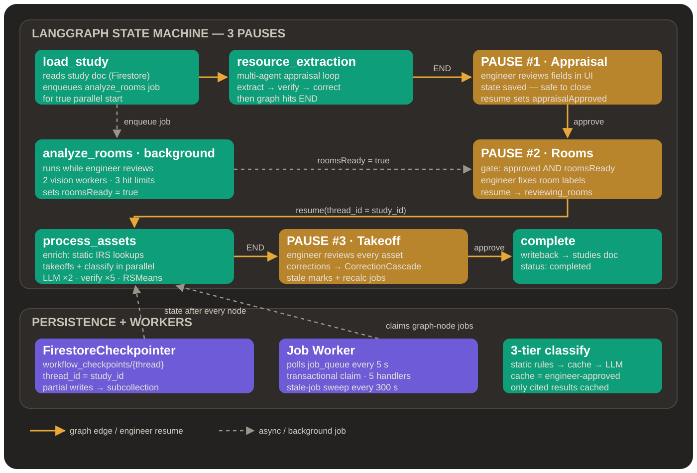
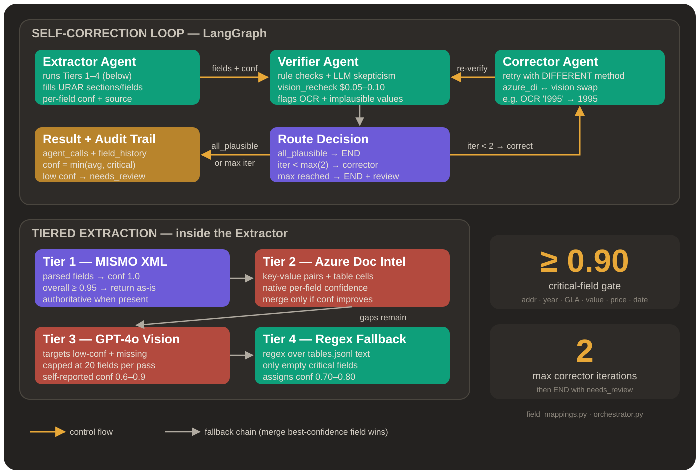

# Basis – Agentic RAG for Document Intelligence


---

> **Cost segregation shouldn't take weeks. Basis gets engineers 80% of the way there—fast, guided, and defensible.**

---

## Status (October 2026)

The system is being rebuilt against a reviewed plan: [REVIEW_AND_PLAN.md](docs/review_2026-10-15/REVIEW_AND_PLAN.md) records what was verified in the code and the cloud project, and [BUILD_PLAN.md](docs/review_2026-10-15/BUILD_PLAN.md) is the build contract. The previous LangGraph workflow is being replaced by Temporal for workflow progress and PostgreSQL for application data. The backend is not currently deployed.

**Works today**
- PDF ingestion (pdfplumber parsing, intact tables, overlapping chunks) and hybrid BM25 + FAISS retrieval over the IRS and RSMeans reference corpus.
- Appraisal field extraction with Azure Document Intelligence, merged with regex extraction and pdfplumber table mapping.
- Per-photo vision classification: one gpt-4o-mini call per photo returns a room type and detected objects.
- Static rules for room and object enrichment, takeoff quantities, cost estimates, and IRS classification of known components. They are unit-tested; apart from room enrichment, they run inside the asset stage, which the current workflow never reaches.

**Does not work today**
- The end-to-end workflow. Only `load_study` and `resource_extraction` are reachable in the LangGraph graph, every resume restarts from the first stage, and the asset pipeline (takeoffs, classification, costs) never runs on the backend.
- Citations on the LLM classification path. Search results are never converted into citations, so every LLM classification is flagged `needs_review`.
- Review rejection. A rejection at the appraisal checkpoint is recorded as an approval, and the frontend has no reject control.

Each of these failures is encoded as a strict `xfail` test in `backEnd/tests/regression/`.

---

**Powered by:**
- **Hybrid retrieval with table preservation** – BM25 with an IRS-aware tokenizer plus FAISS semantic search; tables are stored whole and fetched by id
- **Azure Document Intelligence extraction** – appraisal fields from Azure DI, with regex and table-mapping fallbacks
- **Engineer-in-the-loop design** – the engineer reviews appraisal data, rooms, and assets before anything becomes client-facing

---

## System Architecture



*This diagram shows the original design. Several components in it are not on the live path today: the multi-agent extraction loop, the Grounding DINO / SAM2 vision stages, the MCP connection, and the `FirestoreCheckpointer`-backed resume. The target architecture is in [BUILD_PLAN.md §1](docs/review_2026-10-15/BUILD_PLAN.md#1-target-architecture).*

## Table of Contents

* [Status (October 2026)](#status-october-2026)
* [System Architecture](#system-architecture)
* [What is Basis?](#what-is-basis)
* [Why Cost Seg?](#why-cost-seg)
* [The Problem](#the-problem)
* [The Solution](#the-solution)
* [Demo Video](#demo-video)
* [Current Project Overview](#current-project-overview)
* [The Problem: Document Intelligence at Scale](#the-problem-document-intelligence-at-scale)
* [The Solution: Hybrid Retrieval + Engineer-Reviewed Workflow](#the-solution-hybrid-retrieval--engineer-reviewed-workflow)
* [Architecture Deep Dive](#architecture-deep-dive)
  * [Offline Pipeline — PDF Ingestion](#1-offline-pipeline--pdf-ingestion)
  * [Evidence Layer — Hybrid RAG](#2-evidence-layer-hybrid-rag)
  * [Agent Loop and Workflow (as implemented)](#3-agent-loop-and-workflow-as-implemented)
  * [Appraisal Extraction — Azure Document Intelligence + Regex](#4-appraisal-extraction--azure-document-intelligence--regex)
  * [Vision — Per-Photo Classification](#5-vision--per-photo-classification)
  * [Evidence Tools (in-process LangChain tools)](#6-evidence-tools-in-process-langchain-tools)
* [Tech Stack](#tech-stack)
* [Deployment status](#deployment-status)
* [Engineer-in-the-Loop Workflow](#engineer-in-the-loop-workflow)
* [User Workflow (High Level)](#user-workflow-high-level)
* [Current Application: Cost Segregation](#current-application-cost-segregation)
* [Traction & Validation](#traction--validation)
* [NVIDIA Applicability: Automotive Functional Safety Project](#nvidia-applicability-automotive-functional-safety-project)
* [Accuracy, Safety & Defensibility](#accuracy-safety--defensibility)
* [Data Handling](#data-handling)
* [Why Not Just Use ChatGPT?](#why-not-just-use-chatgpt)
* [System Architecture (Full, as built)](#system-architecture-full-as-built)
* [About](#about)

---

## What is Basis?

**Basis** is an AI-assisted platform for **residential-focused cost segregation firms** that accelerates the most time-consuming part of the study:

> **analyzing hundreds of photos, sketches, and appraisal documents to produce an IRS-ready report.**

Basis is not a "one-click study generator." It's a **human-in-the-loop, agentic workflow** powered by three core systems:

1. **Vision** — per-photo room and object classification with a vision-language model
2. **Evidence Layer** — PDF ingestion pipeline with hybrid BM25 + vector retrieval for IRS-grounded reasoning
3. **Engineer-Reviewed Workflow** — stage-gated review checkpoints for appraisal data, rooms, and assets (being rebuilt on Temporal; see [Status](#status-october-2026))

This architecture **walks the engineer through every decision before anything becomes client-facing.**

---

## Why Cost Seg?

**$1M** That's what you might spend to buy a house. That upfront spend can create **tax savings** as the property depreciates over **27.5 years**.

But 27.5 years is a long time to wait.

**Cost segregation** helps owners **accelerate depreciation** and unlock meaningful savings earlier. In the U.S., there are **5,000+** businesses conducting thousands of studies per year—which makes the workflow opportunity massive.

---

## The Problem

A cost segregation study typically follows three steps:

1. **Document the property**
2. **Analyze the documentation**
3. **Generate the report**

The bottleneck is step 2.

Our interviews revealed that this analysis phase:

* Requires engineers to comb through **hundreds of photos, drawings, and appraisals**
* Can take **2–3 weeks** to complete
* Can cost **>$1,200** in labor per study
* Can leave **>$1,000** in savings on the table due to missed or inconsistently documented components

---

## The Solution

**Enter Basis.**

Engineers upload the property artifacts they already use today. Basis:

* **Organizes documents and imagery**
* **Classifies rooms, materials, and objects**
* **Guides engineers through review checkpoints**
* **Surfaces the exact references** needed for takeoffs and tax classification
  (so engineers aren't hunting across hundreds of pages)

**Result:** faster studies, fewer errors, lower cost to serve.

---

## Demo Video

A short walkthrough showing how Basis guides engineers through appraisal constraints, room/object classification, takeoffs, and IRS-grounded asset decisions.

[](https://youtu.be/ZpUEYUvN5II)

---

## Current Project Overview

* **Objective:**
  Reduce cost seg analysis time by automating repetitive classification and retrieval tasks while preserving engineer-led accuracy and auditability.

* **Core Features:**

  * **Study creation + structured upload**
  * **Appraisal-to-constraints extraction**
  * **Room classification with scene + object context**
  * **Object/component detection with metadata enrichment**
  * **Engineer review checkpoints at every stage**
  * **Engineering takeoffs assistance**
  * **Asset classification with IRS-grounded RAG**
  * **Cost classification hooks for integrated cost databases**
  * **Export-ready outputs for existing firm templates**

---

## The Problem: Document Intelligence at Scale

Many industries require AI-assisted workflows for querying large document sets—regulatory publications, technical standards, safety baselines—that share a common challenge:

> **Standardized headers, messy context.**

These documents contain critical structured data (IDs, codes, classifications, tables) embedded in unstructured narrative text. Traditional approaches fail because:

- **Pure keyword search** misses semantic relationships
- **Pure vector search** hallucinates on exact codes and IDs
- **Context windows** can't hold hundreds of pages
- **LLM-only approaches** lack auditability and traceability

---

## The Solution: Hybrid Retrieval + Engineer-Reviewed Workflow

Basis is built as a **three-layer architecture** for document intelligence problems. The bottom two layers work today; the workflow layer is being rebuilt.

```
┌─────────────────────────────────────────────────────────────────┐
│          WORKFLOW + AGENT LAYER (legacy LangGraph, rebuilding)  │
│  • Stage-gated engineer checkpoints, shown in the frontend      │
│  • Bounded tool-calling loop for residual IRS classification    │
│  • Static rules for enrichment, takeoffs, costs                 │
│  • Rebuild: Temporal workflow + PostgreSQL (see BUILD_PLAN)     │
└────────────────────────────────┬────────────────────────────────┘
                                 │
┌────────────────────────────────▼────────────────────────────────┐
│                     EVIDENCE LAYER (Hybrid RAG)                 │
│  • BM25 for exact-term matches (codes, IDs, classifications)    │
│  • FAISS vector search for semantic similarity                  │
│  • Score fusion + deduplication                                 │
│  • Tables stored intact (never chunked)                         │
└────────────────────────────────┬────────────────────────────────┘
                                 │
┌────────────────────────────────▼────────────────────────────────┐
│                     OFFLINE PIPELINE                            │
│  • Layout-aware PDF parsing (pdfplumber)                        │
│  • Table extraction → structured JSON                           │
│  • Semantic chunking with 80-token overlap                      │
│  • Dual indexing (BM25 + FAISS)                                 │
└─────────────────────────────────────────────────────────────────┘
```

This architecture is **domain-agnostic**. The current implementation targets cost segregation (IRS tax documents), but the same pipeline handles any document corpus with structured codes and unstructured context.

---

## Architecture Deep Dive

### 1) Offline Pipeline — PDF Ingestion

**Location:** `backEnd/evidence_layer/`

Transforms raw PDFs into retrieval-ready indexes through a 5-stage pipeline:

```
┌─────────────────────────────────────────────────────────────────────────────┐
│                         PDF INGESTION PIPELINE                              │
├─────────────────────────────────────────────────────────────────────────────┤
│                                                                             │
│  ┌──────────┐    ┌──────────┐    ┌──────────┐    ┌──────────┐    ┌────────┐ │
│  │  STAGE 1 │───►│  STAGE 2 │───►│  STAGE 3 │───►│  STAGE 4 │───►│STAGE 5 │ │
│  │  Parse   │    │  Extract │    │  Chunk   │    │  Build   │    │ Build  │ │
│  │  Layout  │    │  Tables  │    │  Text    │    │  BM25    │    │ FAISS  │ │
│  └──────────┘    └──────────┘    └──────────┘    └──────────┘    └────────┘ │
│       │               │               │               │              │      │
│       ▼               ▼               ▼               ▼              ▼      │
│   layout/        structured/      retrieval/      indexes/       indexes/   │
│   elements.json  tables.json      chunks.json     bm25.pkl       faiss.idx  │
│                                                                             │
└─────────────────────────────────────────────────────────────────────────────┘
```

---

#### Stage 1: Layout-Aware PDF Parsing

**File:** [`parse_pdf.py`](backEnd/evidence_layer/src/parse_pdf.py)

Extracts text with positional metadata using pdfplumber + PyMuPDF.

```
Raw PDF
   │
   ▼
┌─────────────────────────────────────┐
│  For each page:                     │
│  • Extract text with bbox coords    │
│  • Detect font size + boldness      │
│  • Classify element type            │
│  • Preserve reading order           │
└─────────────────────────────────────┘
   │
   ▼
Layout Elements (with position + type)
```

**Element Classification:**

| Type | Detection Method | Example |
|------|------------------|---------|
| `title` | Large font + bold | "Chapter 4: MACRS" |
| `heading` | Medium font + bold | "Section 1245 Property" |
| `paragraph` | Regular text blocks | Narrative content |
| `list_item` | Numbered/bulleted | "1. Tangible property..." |
| `table` | Grid structure detected | *Routed to Stage 2* |

**Output:** `layout/elements.json` — every text block with page, bbox, font, type.

---

#### Stage 2: Table Extraction (Tables Stay Intact)

**File:** [`extract_tables.py`](backEnd/evidence_layer/src/extract_tables.py)

**Critical design decision:** Tables are NEVER chunked. They're stored as structured JSON and fetched whole.

```
Layout Elements
   │
   ├── Table detected? ──YES──► Extract as structured JSON
   │                            Store in structured/tables.json
   │                            Create surrogate chunk for search
   │
   └── Not a table ──────────► Pass to Stage 3
```

**Why tables stay intact:**
- Chunking tables destroys row/column relationships
- LLMs hallucinate when given partial table data
- Agents fetch full table by `table_id` when surrogate matches

**Table Storage Format:**

```json
{
  "table_id": "DOC_2024_table_3",
  "page": 15,
  "caption": "Table B-1. Asset Classes",
  "headers": ["Asset Class", "Description", "Recovery Period"],
  "rows": [
    ["57.0", "Distributive Trades", "5 years"],
    ["00.11", "Office Furniture", "7 years"]
  ],
  "markdown": "| Asset Class | Description | Recovery Period |\n|---|---|---|\n| 57.0 | ..."
}
```

**Surrogate Chunk (for search):**
```json
{
  "chunk_id": "DOC_2024_table_3_surrogate",
  "type": "table_surrogate",
  "text": "Table B-1. Asset Classes: 57.0 Distributive Trades 5 years, 00.11 Office Furniture 7 years...",
  "table_id": "DOC_2024_table_3"
}
```

When search hits the surrogate → agent calls `get_table(table_id)` → returns full structured table.

**URAR Appraisal Mapping:**

For appraisal documents, extracted tables are additionally mapped to URAR (Uniform Residential Appraisal Report) sections:

```
┌─────────────────────────────────────────────────────────────────┐
│              APPRAISAL TABLE → SECTION MAPPING                   │
├─────────────────────────────────────────────────────────────────┤
│                                                                  │
│  Extracted Tables (.tables.jsonl)                                │
│         │                                                        │
│         ▼                                                        │
│  ┌─────────────────────────────────────┐                         │
│  │  map_appraisal_sections.py          │                         │
│  │                                     │                         │
│  │  1. Identify section by keywords    │                         │
│  │     + page position (URAR layout)   │                         │
│  │                                     │                         │
│  │  2. Map table rows → section fields │                         │
│  │     (subject, neighborhood, etc.)   │                         │
│  │                                     │                         │
│  │  3. Fallback to regex extraction    │                         │
│  │     for missing values              │                         │
│  └─────────────────────────────────────┘                         │
│         │                                                        │
│         ▼                                                        │
│  Frontend-ready sections:                                        │
│  • subject (address, borrower, lender)                           │
│  • listing_and_contract (price, DOM, sale type)                  │
│  • neighborhood (location, growth, values)                       │
│  • site (dimensions, zoning, utilities)                          │
│  • improvements (foundation, rooms, year built)                  │
│  • sales_comparison (comps grid)                                 │
│  • cost_approach (site value, depreciation)                      │
│  • reconciliation (final value opinion)                          │
│                                                                  │
└─────────────────────────────────────────────────────────────────┘
```

This mapping uses the same table extraction from ingestion—no additional parsing or GPT calls required. On the live path it is the fallback when Azure Document Intelligence is unavailable or returns low confidence (see [Appraisal Extraction](#4-appraisal-extraction--azure-document-intelligence--regex)).

**Tiered Extraction (implemented, not on the live path)**

`backEnd/evidence_layer/src/tiered_extraction/` contains a `TieredExtractor` with a multi-tier approach and confidence scoring. The workflow does not call it; it calls only the Azure DI extractor from this package.

```
┌─────────────────────────────────────────────────────────────────┐
│                    TIERED EXTRACTION                             │
├─────────────────────────────────────────────────────────────────┤
│  Tier 1: MISMO XML Parser (confidence: 1.0)                    │
│     ↓ (if unavailable)                                          │
│  Tier 2: Azure Document Intelligence (confidence: 0.7-0.95)     │
│     ↓ (for fields with confidence < 0.85)                       │
│  Tier 3: GPT-4o Vision Fallback (confidence: 0.6-0.9)          │
│     ↓ (for any remaining empty fields)                          │
│  Tier 4: Regex Fallback (confidence: 0.5-0.8)                  │
│     ↓                                                           │
│  Tier 5: Validation & Confidence Aggregation                    │
└─────────────────────────────────────────────────────────────────┘
```

**Design:**
- **Field-level confidence scoring** — Each field tracks confidence + source
- **Critical field validation** — `CRITICAL_FIELDS` lists `property_address`, `year_built`, `gross_living_area`, `appraised_value`, `contract_price`, `effective_date` at >= 0.90 confidence. Known bug: the mapping tables now emit `gla_sqft`, `effective_date_of_appraisal`, and `final_market_value`, so three critical fields always read as missing and `needs_review` is always true (regression test: `test_legacy_critical_fields_mapping.py`)
- **Automatic review flagging** — `needs_review: true` when confidence thresholds not met
- **Fallback chain** — Falls back through tiers if services are unavailable

---

#### Stage 3: Semantic Chunking with Overlap

**File:** [`chunk_text.py`](backEnd/evidence_layer/src/chunk_text.py)

Splits narrative text into retrieval units with semantic overlap.

```
Non-Table Elements
   │
   ▼
┌─────────────────────────────────────┐
│  Chunking Parameters:               │
│  • Target: 400 tokens               │
│  • Overlap: 80 tokens               │
│  • Hard max: 700 tokens             │
│  • Tokenizer: cl100k_base (GPT-4)   │
└─────────────────────────────────────┘
   │
   ▼
Chunks with provenance metadata
```

**Why 80-token overlap?**

```
Without overlap:
┌──────────────────┐ ┌──────────────────┐
│ Chunk 1          │ │ Chunk 2          │
│ "...property     │ │ includes assets  │
│ under Section"   │ │ classified as... │
└──────────────────┘ └──────────────────┘
        ▲                    ▲
        └── Boundary loss ───┘
            "Section 1245 property includes..."
            is split and context is lost

With 80-token overlap:
┌──────────────────────────┐
│ Chunk 1                  │
│ "...property under       │
│ Section 1245 includes    │◄── Overlap
│ assets classified..."    │
└──────────────────────────┘
              ┌──────────────────────────┐
              │ Chunk 2                  │
     Overlap ►│ "Section 1245 includes   │
              │ assets classified as     │
              │ tangible personal..."    │
              └──────────────────────────┘

Both chunks contain the full context.
```

**Chunk Output:**

```json
{
  "chunk_id": "DOC_2024_chunk_15",
  "type": "text",
  "text": "Section 1245 property includes tangible personal property...",
  "page_span": [12, 12],
  "element_ids": ["DOC_2024_p12_e3", "DOC_2024_p12_e4"],
  "section_path": ["How To Depreciate Property", "Section 1245"],
  "token_count": 387
}
```

---

#### Stage 4: BM25 Index (Lexical Search)

**File:** [`build_bm25.py`](backEnd/evidence_layer/src/build_bm25.py)

Builds lexical index with **custom tokenization** for exact code matching.

```
Chunks
   │
   ▼
┌─────────────────────────────────────┐
│  Custom Tokenizer (not whitespace!) │
│                                     │
│  "§1245 property"                   │
│       ▼                             │
│  ["§1245", "1245", "property"]      │
└─────────────────────────────────────┘
   │
   ▼
BM25Okapi Index (bm25.pkl)
```

**Why custom tokenization matters:**

Standard tokenizers break regulatory codes:

| Standard Tokenizer | Custom Tokenizer |
|--------------------|------------------|
| `["§", "1245"]` ❌ | `["§1245", "1245"]` ✓ |
| `["168", "(", "e", ")"]` ❌ | `["168(e)(3)", "168"]` ✓ |
| `["57", ".", "0"]` ❌ | `["57.0", "57"]` ✓ |

**Tokenizer patterns** ([`tokenizers.py`](backEnd/evidence_layer/src/tokenizers.py)):

| Pattern | Example | Tokens Generated |
|---------|---------|------------------|
| Section symbols | `§1245` | `["§1245", "1245"]` |
| Parenthetical refs | `168(e)(3)(B)` | `["168(e)(3)(b)", "168"]` |
| Decimal codes | `57.0`, `00.11` | `["57.0", "57"]` |
| Mixed references | `Section 179(d)` | `["section", "179(d)", "179"]` |

```python
>>> irs_tokenize("§1245 property depreciation")
['§1245', '1245', 'property', 'depreciation']

>>> irs_tokenize("Asset class 57.0 under Section 168(e)(3)")
['asset', 'class', '57.0', '57', 'section', '168(e)(3)', '168']
```

This ensures queries for `"1245"` match documents containing `"§1245"` or `"Section 1245"`. The same pattern applies to any domain with structured identifiers (hazard IDs, ASIL levels, requirement codes).

---

#### Stage 5: FAISS Index (Semantic Search)

**File:** [`build_faiss.py`](backEnd/evidence_layer/src/build_faiss.py)

Builds vector index for semantic similarity.

```
Chunks
   │
   ▼
┌─────────────────────────────────────┐
│  Sentence Transformer               │
│  Model: all-MiniLM-L6-v2            │
│  Dimensions: 384                    │
└─────────────────────────────────────┘
   │
   ▼
┌─────────────────────────────────────┐
│  FAISS Index (IndexFlatIP)          │
│  • Cosine via normalized vectors    │
│  • Metadata mapping (chunk_id)      │
└─────────────────────────────────────┘
   │
   ▼
faiss.idx + metadata.json
```

**When to use semantic search:**
- Conceptual queries: "What qualifies for accelerated depreciation?"
- Paraphrased questions: "equipment that wears out quickly"
- Related concepts: "tangible personal property" → finds "Section 1245"

---

#### Pipeline Output Summary

After ingestion, each document produces:

```
data/{corpus}/{doc_id}/
├── layout/
│   └── elements.json      # Raw parsed elements with position
├── structured/
│   └── tables.json        # Complete tables (never chunked)
├── retrieval/
│   └── chunks.json        # Text chunks with overlap + provenance
└── indexes/
    ├── bm25/
    │   └── index.pkl      # Lexical search index
    └── vector/
        ├── faiss.idx      # Semantic search index
        └── metadata.json  # Chunk ID mapping
```

---

### 2) Evidence Layer (Hybrid RAG)

**Location:** `backEnd/evidence_layer/src/retrieval.py`

Combines lexical and semantic search with score normalization.

**Retrieval Flow:**

```
Query
  │
  ├──► BM25 Search ──► Normalized Scores ──┐
  │    (exact codes)                       │
  │                                        ├──► Score Fusion ──► Deduplicate ──► Results
  │                                        │
  └──► Vector Search ─► Normalized Scores ─┘
       (semantic)
```

**API:**

```python
# BM25 for exact codes/IDs
results = bm25_search("IRS_PUB946_2024", "1245", top_k=5)

# Vector for semantic queries
results = vector_search("IRS_PUB946_2024", "equipment depreciation", top_k=5)

# Hybrid (recommended) - configurable BM25 weight
results = hybrid_search("IRS_PUB946_2024", "tangible personal property", top_k=5, bm25_weight=0.5)
```

**Key Features:**
- Automatic score normalization before fusion
- Deduplication of overlapping results
- Table expansion: when surrogate chunks match, full table returned
- Supports both "reference" corpus (shared docs) and "study" corpus (per-case docs)

---

### 3) Agent Loop and Workflow (as implemented)

**Location:** `backEnd/agentic/`

**The agent loop.** Each stage agent extends `BaseStageAgent` (`agents/base_agent.py`). Its `run()` is a plain tool-calling loop: call the model with the evidence tools bound, execute any requested tool calls in-process, append the results, and stop when the model answers without tool calls or after `agent_max_iterations` (5). It does not use LangGraph's `create_react_agent`. The tools are LangChain `@tool` wrappers over the evidence layer, called in the same process (see [Evidence Tools](#6-evidence-tools-in-process-langchain-tools)).

**What is static.** Room enrichment, object enrichment, takeoffs, and cost estimates run with `use_static=True`: dictionary lookups and formulas, no LLM. IRS classification checks static rules first, then a cache of engineer-approved results, and calls the LLM loop only for the remainder. LLM calls are made for photo analysis, residual classification, and classification verification.

**Reproduced defects** (details in [REVIEW_AND_PLAN.md A.3](docs/review_2026-10-15/REVIEW_AND_PLAN.md#a3-workflow-and-agent-correctness-topic-3)):
- Only `load_study` → `resource_extraction` (or `error_handler`) is reachable from START; `analyze_rooms`, `reviewing_rooms`, `process_assets`, and `complete` have no incoming path.
- Every "pause" is a graph `END`, not an interrupt. `resume_workflow` re-invokes the graph, which starts again from START and runs `load_study` → `resource_extraction` whatever the stage.
- `resume_workflow(..., engineer_approved=False)` at the appraisal checkpoint writes `appraisalApproved: True`.
- `_extract_citations_from_messages` drops every tool result, so LLM-path classifications have no citations, confidence 0.3, and `needs_review: true`.

#### Design intent: selective retrieval

The retrieval design targets **context window saturation**: when documents are large or interrelated, naive RAG retrieves too much context. The intended pattern is that the agent plans what evidence it needs, retrieves selectively, and checks sufficiency before answering. In the current code this pattern exists only inside the residual classification loop, which the live workflow never reaches.



*Original design diagram. The hybrid retrieval, custom tokenizer, and whole-table store match the code. The "MCP Evidence Server" box does not: agents call the same functions as in-process LangChain tools. The "Citation Gate" does not work on the LLM path today (see above).*

```
┌─────────────────────────────────────────────────────────────────────────────┐
│                  NAIVE RAG vs SELECTIVE RETRIEVAL (design)                  │
├─────────────────────────────────────────────────────────────────────────────┤
│                                                                             │
│  NAIVE RAG:                          SELECTIVE RETRIEVAL:                   │
│  Query → retrieve top-k → generate   Query → plan evidence needed           │
│                                            → choose BM25 / vector / table   │
│  ❌ may retrieve too much or the            → retrieve only what is needed   │
│     wrong documents                        → check sufficiency              │
│                                            → answer with citations          │
│                                                                             │
└─────────────────────────────────────────────────────────────────────────────┘
```

---

#### Workflow: intended design vs as built

The legacy LangGraph workflow was designed around **3 engineer checkpoints** matching the frontend UI. As built, the graph does not connect them:

```
INTENDED (legacy design)                         AS BUILT (graph edges at HEAD)
─────────────────────────────────────────        ─────────────────────────────────
load_study                                       START → load_study
  ├─ resource_extraction                                  ├─ error_handler → END
  │    → PAUSE 1: engineer reviews appraisal              └─ resource_extraction → END
  └─ analyze_rooms (background job)
PAUSE 2: engineer reviews rooms                  No path from START to:
  → reviewing_rooms → process_assets               analyze_rooms, reviewing_rooms,
  → PAUSE 3: engineer reviews assets               process_assets, complete
  → complete
```

`analyze_rooms` still runs: `load_study` enqueues it as a job and the job worker calls the node directly. `process_assets` has a job handler, but nothing enqueues it, so takeoffs, classification, costs, and the evidence pack do not run on the backend. The frontend's engineering-takeoff page runs on client-side demo models, and the browser writes `workflowStatus` to Firestore directly.



*Original design diagram of the legacy LangGraph workflow. It shows the intended three-pause flow, not the graph that compiles today.*

**Frontend WorkflowStatus values:**
```
uploading_documents → analyzing_rooms → resource_extraction → reviewing_rooms → engineering_takeoff → completed
```

**Planned (see [BUILD_PLAN §1](docs/review_2026-10-15/BUILD_PLAN.md#1-target-architecture)).** One Temporal `StudyWorkflow` per study. It runs appraisal ingestion and field extraction, fans out photo analysis per photo, then waits for `appraisal_decision`, `rooms_decision`, and `assets_decision` signals from the API. A rejection with corrections re-runs the affected activities and waits again. Each approval references the exact revision it approved. Activities are idempotent, keyed by `(study_id, input_revision, activity)`, and write to PostgreSQL.

---

#### Residual classification loop (AssetAgent)

The AssetAgent system prompt (`agents/asset_agent.py`) tells the model to search IRS guidance, choose a section (1245/1250) and MACRS bucket, verify the pair with `validate_section_bucket_tool`, check consistency with `check_component_context_tool`, and call `reconsider_classification` if validation fails. These steps are prompted, not enforced by code. The output schema includes `citation_refs`.

#### Agents and how they run today

| Agent | Purpose | How it runs today |
|-------|---------|-------------------|
| **VisionAgent** | Room type and objects per photo | gpt-4o-mini, one call per photo, 2 concurrent; run by the job worker |
| **RoomAgent** | Room enrichment | Static lookup (`use_static=True`) |
| **ObjectAgent** | Component enrichment | Static lookup (`use_static=True`) |
| **TakeoffAgent** | Quantity estimation | Static formulas (`use_static=True`) |
| **AssetAgent** | MACRS classification | Static rules → engineer-approved cache → LLM loop with evidence tools |
| **ClassificationVerifier** | IRS defensibility checks | LLM |
| **CostAgent** | RSMeans cost estimates | Static calculation (`use_static=True`) |

Every agent after VisionAgent is called from `process_assets`, which the live workflow does not reach.

---

#### Evidence requirement: "no evidence, no claim" (being built)

Today nothing enforces this. On the LLM path citations are always empty, for three independent reasons in `agents/base_agent.py`: the `ToolMessage` built in `run()` has no `name`, which the citation filter requires; the registered tool names end in `_tool`, which the filter does not accept; and tool results are serialized with `str()`, which `json.loads` cannot parse. Static-rule classifications carry their own pre-populated IRS citations and are unaffected.

"No evidence, no claim" is the invariant being built and tested in the rebuild ([BUILD_PLAN §6.6](docs/review_2026-10-15/BUILD_PLAN.md#66-behavioral-evals-scripted-model-pr-gate)): no search means `needs_review` with confidence ≤ 0.3, a nonexistent chunk id is rejected, and a model cannot request another study's corpus.

---

#### Agent Output Schema

`AgentOutput` (`agents/base_agent.py`) carries the structured result, `citations`, `confidence`, `needs_review`, and `review_reason`. The intended shape of an asset classification, as an example:

```json
{
  "asset_classification": {
    "bucket": "5-year",
    "life_years": 5,
    "section": "1245",
    "asset_class": "57.0",
    "macrs_system": "GDS",
    "irs_note": "Carpeting in residential rental property is Section 1245 property..."
  },
  "citations": [
    {"chunk_id": "IRS_PUB946_2024_chunk_42", "page": 15, "text": "Section 1245 property includes..."},
    {"chunk_id": "IRS_ATG_2024_chunk_88", "page": 34, "text": "Floor coverings are typically..."}
  ],
  "confidence": 0.92,
  "needs_review": false,
  "reasoning": "Found explicit IRS guidance classifying floor coverings as 1245 property..."
}
```

On the LLM path today, `citations` is empty and `confidence` is 0.3.

---

#### Checkpointing & Observability

**Checkpointing:**
- `create_workflow()` uses `FirestoreCheckpointer` (`agentic/firestore/checkpointer.py`) when `GCS_BUCKET_NAME` is set, and otherwise creates a new in-memory `MemorySaver` on every call, so in development nothing persists between start and resume.
- Resume does not read the checkpoint. `resume_workflow` reads `workflowStatus` from the study document and re-invokes the graph from START.
- `FirestoreCheckpointer` stores only the latest checkpoint per thread and does not return pending writes or parent configs.

**LangSmith:**
- The API process calls `configure_langsmith()` at startup, which covers graph runs started by `/workflow/start` and `/workflow/resume` (these run inside the HTTP request).
- The job worker does not configure LangSmith, so photo analysis run by the worker is not traced.

**LangSmith Dashboard:**


---

### 4) Appraisal Extraction — Azure Document Intelligence + Regex

**Location:** `resource_extraction_node` in `backEnd/agentic/graph/nodes.py`, using `backEnd/evidence_layer/`

This is the extraction path the workflow runs today:

```
┌─────────────────────────────────────────────────────────────────────────────┐
│                     APPRAISAL EXTRACTION (live path)                        │
├─────────────────────────────────────────────────────────────────────────────┤
│                                                                             │
│  Appraisal PDF (downloaded from its storage URL)                            │
│     │                                                                       │
│     ├── Phase 1, in parallel                                                │
│     │     • ingest_document: parse → tables → chunks → BM25 + FAISS         │
│     │     • AzureDocumentExtractor: Azure DI key-value pairs + tables       │
│     │                                                                       │
│     ├── Phase 2, after ingest (pdfplumber is not thread-safe)               │
│     │     • extract_appraisal_fields: regex over the PDF text               │
│     │                                                                       │
│     └── Merge                                                               │
│           Azure DI confidence > 0.3 → Azure DI sections, cleaned by         │
│                                       azure_di_cleaner; regex fills gaps    │
│           else, tables exist        → URAR table → section mapping,         │
│                                       regex fallback                        │
│           else                      → regex fields only                     │
│                                                                             │
└─────────────────────────────────────────────────────────────────────────────┘
```

The result is written to the study as `appraisalResources`, with an extraction audit recording the method used, the Azure DI confidence, and phase timings.

**Not used: multi-agent extraction loop.** `backEnd/agentic/agents/appraisal/` contains an Extractor → Verifier → Corrector LangGraph `StateGraph` (bounded correction iterations) with tools for MISMO XML, Azure DI, GPT-4o vision, validation, and vision re-checks. The workflow does not import it.



*Design of the multi-agent loop in `agents/appraisal/`. This code is not called by the workflow; live extraction is the Azure DI + regex path above.*

**Planned (see BUILD_PLAN).** `ingest_appraisal` and `extract_fields` become Temporal activities: deterministic Azure DI + regex + validation rules, with a single targeted LLM call only for fields that fail validation ([REVIEW_AND_PLAN B.1](docs/review_2026-10-15/REVIEW_AND_PLAN.md#b1-does-langgraph-belong-here-topic-2)).

---

### 5) Vision — Per-Photo Classification

**Location:** `backEnd/agentic/agents/vision_agent.py` (live), `backEnd/vision_layer/` (implemented, not wired)

**Live path.** `load_study` enqueues an `analyze_rooms` job; the job worker runs `analyze_rooms_node`, which calls `analyze_study_images` with 2 concurrent workers. Each photo is sent whole to gpt-4o-mini (Azure OpenAI, with an OpenAI fallback after a rate-limit error). The model returns a room type and detected objects as structured JSON, and the node writes the resulting rooms to the study.

**`vision_layer/` (implemented, not wired).** This package implements a detection-first pipeline intended to reduce VLM hallucinations by classifying cropped regions instead of whole images. No module in `agentic/` imports it. It has its own unit tests.

```
┌──────────────────────────────────────────────────────────────────────────────┐
│               vision_layer/ PIPELINE — DETECTION FIRST (not wired)           │
├──────────────────────────────────────────────────────────────────────────────┤
│                                                                              │
│  ┌──────────┐    ┌──────────┐    ┌──────────┐    ┌──────────┐    ┌─────────┐ │
│  │  STAGE 1 │───►│  STAGE 2 │───►│  STAGE 3 │───►│  STAGE 4 │───►│STAGE 5  │ │
│  │  Detect  │    │  Segment │    │   Crop   │    │ Classify │    │ Verify  │ │
│  │  Objects │    │  Regions │    │  Regions │    │   VLM    │    │Grounding│ │
│  └──────────┘    └──────────┘    └──────────┘    └──────────┘    └─────────┘ │
│       │               │               │               │              │       │
│       ▼               ▼               ▼               ▼              ▼       │
│  Grounding       SAM 2           Cropped         Material      Validated     │
│  DINO 1.5        Masks           Images          Attrs         Artifacts     │
│                                                                              │
└──────────────────────────────────────────────────────────────────────────────┘
```

| Stage | File | What it does |
|-------|------|--------------|
| Detect | [`api_clients/grounding_dino.py`](backEnd/vision_layer/src/api_clients/grounding_dino.py) | Open-vocabulary detection via Replicate; default box threshold 0.3 |
| Segment | [`api_clients/sam2.py`](backEnd/vision_layer/src/api_clients/sam2.py) | SAM 2 masks from detection boxes (optional) |
| Crop | [`pipeline/cropper.py`](backEnd/vision_layer/src/pipeline/cropper.py) | Crops each detection with 20% padding |
| Classify | [`api_clients/vlm.py`](backEnd/vision_layer/src/api_clients/vlm.py) | VLM classification of each crop (component type, material, condition, installation type) |
| Orchestrate | [`pipeline/ingest.py`](backEnd/vision_layer/src/pipeline/ingest.py) | Runs the stages per image with a concurrency semaphore |

**Planned.** BUILD_PLAN keeps one structured-output VLM call per photo as the `analyze_photo` activity. Re-wiring detection-first is optional ([REVIEW_AND_PLAN B.1](docs/review_2026-10-15/REVIEW_AND_PLAN.md#b1-does-langgraph-belong-here-topic-2)).

---

### 6) Evidence Tools (in-process LangChain tools)

Agents reach the evidence layer through LangChain `@tool` functions in `backEnd/agentic/mcp_server/tools/`, bound to the model and executed in the agent's own process:

| Registered tool | Purpose |
|-----------------|---------|
| `bm25_search_tool` | Exact token matching (codes, IDs, standard references) |
| `vector_search_tool` | Semantic similarity for conceptual queries |
| `hybrid_search_tool` | Combined search with score fusion |
| `get_chunk_tool` | Fetch chunk by ID with full provenance |
| `get_table_tool` | Fetch structured table (never chunked) |

`backEnd/agentic/mcp_server/server.py` also exposes the same five functions as an MCP server over stdio (`bm25_search`, `vector_search`, `hybrid_search`, `get_table`, `get_chunk`). Nothing in the application launches that server or connects to it.

**Tool signature (from `mcp_server/tools/search_tools.py`):**

```python
@tool
def hybrid_search_tool(
    doc_id: str,
    query: str,
    top_k: int = 10,
    corpus: str = "reference",
    study_id: Optional[str] = None,
    bm25_weight: float = 0.5,
) -> list[dict]:
    """Combined BM25 + vector search with score fusion.
    Automatically expands table surrogate hits to include full table data."""
```

`corpus` and `study_id` are arguments the model supplies. Binding them to the current study on the server side is part of the rebuild (BUILD_PLAN §6.6, tool scope test).

---

## Tech Stack

### Backend

| Component | Technology |
|-----------|------------|
| **Framework** | FastAPI |
| **Workflow Orchestration** | Temporal (in progress; LangGraph being removed) |
| **LLM** | Azure OpenAI (gpt-4o-mini for vision, GPT-5-nano for text), OpenAI as rate-limit fallback |
| **Document Intelligence** | Azure Document Intelligence (appraisal extraction) |
| **PDF Parsing** | pdfplumber, PyMuPDF |
| **Vector Store** | FAISS (moving to PostgreSQL + pgvector) |
| **Lexical Search** | rank-bm25 |
| **Embeddings** | sentence-transformers (`all-MiniLM-L6-v2`) |
| **Observability** | LangSmith (API process only) |
| **Database** | Firestore (migrating to PostgreSQL) |
| **Storage** | Firebase Storage, GCS |

### Frontend

| Component | Technology |
|-----------|------------|
| **Framework** | Next.js 14 (App Router) |
| **Language** | TypeScript |
| **Styling** | TailwindCSS |
| **Auth/DB** | Firebase |

### Infrastructure

- **Containers:** `backEnd/Dockerfile` and a development `docker-compose.yml` (API + job worker)
- **Workflow state today:** study document fields in Firestore; the LangGraph checkpointer is not used on resume
- **Target:** Cloud Run (API + worker), Cloud SQL PostgreSQL, Temporal, GCS — see [BUILD_PLAN §1](docs/review_2026-10-15/BUILD_PLAN.md#1-target-architecture)

---

## Deployment status

Facts as verified on 2026-10-15 ([REVIEW_AND_PLAN.md A.7](docs/review_2026-10-15/REVIEW_AND_PLAN.md#a7-build-and-deploy-configuration-verified)):

- **Backend: not deployed.** No Cloud Run service or job exists in the `cost-seg-basis` project.
- **Frontend: Firebase App Hosting backend bound to an older repository.** The App Hosting backend `basisbackend` is connected to a different repository and was last updated before this repository's first substantive commit, so it does not serve this code.
- **`docker-compose.yml` is a development setup.** It bind-mounts the source and runs uvicorn with `--reload`, plus a separate job-worker container (`agentic.workers.job_worker`). It is not a production topology.
- **No deployment pipeline yet.** CI for lint and tests is being added in Stage 0 of the rebuild; there is no Cloud Build config, deploy workflow, or infrastructure-as-code.
- **Target topology:** API and worker on Cloud Run, PostgreSQL on Cloud SQL, Temporal for workflow progress, GCS for files, separate staging, GitHub Actions with OIDC. See [BUILD_PLAN §1](docs/review_2026-10-15/BUILD_PLAN.md#1-target-architecture) and [§7](docs/review_2026-10-15/BUILD_PLAN.md#7-cicd-pipeline).

---

## Engineer-in-the-Loop Workflow

Every module follows the same contract:

1. **Frontend triggers module** with `{ studyId }`
2. **Backend fetches** the required data from Firestore/Storage
3. **Backend runs AI/ML**
4. **Backend writes results** back to Firestore
5. **Frontend renders results**
6. **Engineer reviews + corrects**
7. **Engineer manually advances** to the next stage

This is the core design principle that keeps deliverables defensible. Today the contract holds for appraisal extraction and photo analysis. The asset stages on the engineering-takeoff page run on client-side demo models, and the browser writes stage status to Firestore directly; in the rebuild, the API is the only writer and stage moves happen only through recorded engineer decisions ([BUILD_PLAN §1](docs/review_2026-10-15/BUILD_PLAN.md#1-target-architecture)).

---

## User Workflow (High Level)

This is the product flow as presented in the UI. Steps 5–8 currently run on client-side demo models in the frontend, not on the backend (see [Status](#status-october-2026)).

1. 📝 **Create New Study**

   * Engineer enters property name
   * Selects files to upload (photos, PDFs, appraisals)
   * Clicks **Start Analysis**

2. ⬆️ **Upload Documents**

   * Files upload to Firebase Storage
   * Progress tracked in UI

3. 📄 **Appraisal Processing**

   * Ingest PDF using same pipeline as IRS docs (parse → chunk → index)
   * Extract tables with structure preserved (headers, rows, page)
   * **Field extraction:** Azure Document Intelligence in parallel with ingestion, then regex extraction; Azure DI values are cleaned and regex values fill gaps
   * If Azure DI is unavailable or low-confidence: map URAR tables to frontend sections (subject, neighborhood, site, improvements, etc.), with regex fallback
   * Store the extraction method and Azure DI confidence with the results
   * ⏸️ **Engineer reviews + corrects**

4. 🏠 **Room Classification**

   * Scene + material + object context
   * Groups photos into predicted rooms
   * ⏸️ **Engineer reviews + corrects**

5. 🔍 **Object Classification**

   * Detects components from photos
   * Enriches with room context + metadata
   * ⏸️ **Engineer reviews + corrects**

6. 📐 **Engineering Takeoffs**

   * Calculates measurements
   * ⏸️ **Engineer reviews + corrects**

7. 💰 **Asset Classification**

   * IRS-grounded classification
   * ⏸️ **Engineer reviews + corrects**

8. 🧾 **Cost Classification**

   * Maps components to integrated cost databases
   * ⏸️ **Engineer reviews + corrects**

9. ✅ **Complete Study**

   * Export package generated for firm templates

---

## Current Application: Cost Segregation

The architecture currently targets **cost segregation**—accelerating tax depreciation analysis for commercial real estate.

**Domain-Specific Implementation:**

- **Reference Corpus:** IRS Pub 946, Pub 527, Cost Seg ATG, Rev Proc 87-56, RSMeans databases
- **Exact-Match Queries:** Asset class codes (e.g., `"57.0"`), IRS sections (e.g., `"§1245"`)
- **Semantic Queries:** "What property qualifies for 5-year depreciation?"
- **Traceability:** Static-rule classifications carry IRS citations; citations on the LLM path are broken today and are a tested invariant in the rebuild
- **Vision Processing:** One vision-language model call per property photo (see [Vision](#5-vision--per-photo-classification))

---

## Traction & Validation

This isn't a proof-of-concept—it's a deployed product with paying customers.

**Customers:**
- **CSSI** (top-5 cost segregation firm) — paying user
- **CBIZ** — paying user
- Design partners at multiple top-5 firms have validated **50%+ time savings** on analysis workflows

**Awards:**

### LavaLab Fall 2025 — Best Traction


---

## NVIDIA Applicability: Automotive Functional Safety Project

The Basis architecture directly addresses the document intelligence challenges in ISO 26262 workflows.

**The Problem:**

Functional safety teams work with large document sets—HARA baselines, safety goals, TSRs, verification evidence—that share a common structure:
- **Standardized headers** (hazard IDs, ASIL classifications, requirement codes)
- **Messy context sections** (rationale, assumptions, linked evidence)
- **Strict traceability requirements** (every claim must cite source documents)

Querying these documents with traditional RAG fails: vector search hallucinates on exact IDs, keyword search misses semantic relationships, and LLMs can't process hundreds of pages in context.

**Architecture Mapping:**

| Basis Component | Functional Safety Application |
|-----------------|-------------------------------|
| **Custom BM25 Tokenization** | Preserve `HAZ-001`, `TSR-042`, `ASIL-D`, `ISO 26262-6:2018 §7.4.3` as atomic tokens |
| **Tables Never Chunked** | FMEA tables, DFA matrices, traceability matrices stay intact |
| **80-Token Overlap** | Safety goal rationale spanning paragraphs isn't split |
| **Hybrid Search** | Exact ID lookup + semantic "what evidence supports this safety goal?" |
| **Surrogate → Full Table** | Search hits "FMEA row for HAZ-001" → returns complete FMEA with all columns |
| **Citation Requirement** | "No evidence, no claim" — the invariant being built and tested in the rebuild (BUILD_PLAN §6.6) |
| **Human-in-the-Loop** | Engineer reviews before any safety decision is finalized |

**Example Queries This Architecture Handles:**

```
Exact ID lookup (BM25):
  "TSR-042" → finds all chunks referencing TSR-042

Semantic search (FAISS):
  "verification evidence for braking system hazards" → finds related test reports

Hybrid (recommended):
  "ASIL-D requirements for sensor fusion" → exact ASIL match + semantic relevance

Table fetch:
  Search hits FMEA surrogate → get_table() returns full FMEA with hazard, severity, exposure, controllability
```

**Tokenizer Adaptation:**

The custom tokenizer pattern extends directly to safety document codes:

| IRS Pattern | Safety Pattern | Tokenizer Handles |
|-------------|----------------|-------------------|
| `§1245` | `HAZ-001` | Prefix + number preserved |
| `168(e)(3)` | `ISO 26262-6:2018 §7.4.3` | Nested references preserved |
| `57.0` | `ASIL-D` | Alphanumeric codes preserved |
| `Rev Proc 87-56` | `TSR-042-REV-A` | Multi-part identifiers preserved |

**What Would Change for Safety Documents:**

1. **Tokenizer regex** — add patterns for `HAZ-\d+`, `TSR-\d+`, `ASIL-[A-D]`, ISO clause refs
2. **Reference corpus** — ingest ISO 26262 parts, internal HARA baselines, verification templates
3. **Agent prompts** — swap IRS classification logic for safety goal verification logic
4. **Structured store** — FMEA tables, DFA matrices instead of depreciation tables

The ingestion pipeline and hybrid retrieval would carry over unchanged.

---

## Accuracy, Safety & Defensibility

Basis is designed for **engineering-grade output**, not generic AI chat.

What is in place today:

* **Retrieval over the actual IRS documents** — hybrid BM25 + vector search over ingested IRS publications, with tables kept whole
* **Deterministic rules first** — static rules classify, enrich, measure, and cost known components and carry their own IRS citations (unit-tested; see [Status](#status-october-2026) for which of them run today)
* **Human-in-the-loop checkpoints** — the UI gates appraisal, room, and asset review; a reject path is not implemented yet
* **Confidence scoring + needs_review flags** — low-confidence outputs are flagged; on the LLM classification path every result is flagged today because citations are lost (see [section 3](#3-agent-loop-and-workflow-as-implemented))

What the rebuild adds, each as a test in [BUILD_PLAN §6](docs/review_2026-10-15/BUILD_PLAN.md#6-the-full-test-inventory):

* **"No evidence, no claim"** — the invariant being built and tested ([BUILD_PLAN §6.6](docs/review_2026-10-15/BUILD_PLAN.md#66-behavioral-evals-scripted-model-pr-gate)): no search means `needs_review` with confidence ≤ 0.3, and a citation must resolve to a real chunk
* **Rejection never records approval**, and approvals bind to the exact revision reviewed
* **Tool scope** — a model cannot request another study's documents

---

## Data Handling

* Customer artifacts are stored in **Firebase Storage**, which encrypts data at rest.
* Study data is stored in **Firestore** with owner-only security rules.
* LLM and document calls go to Azure OpenAI and Azure Document Intelligence, with the OpenAI API as a rate-limit fallback; none of these train on API data by default.
* No known client file is tracked in this public repository. `docs/review_2026-10-15/blocked_file_hashes.txt` lists SHA-256 hashes of known client files so they can be blocked from commits.

---

## Why Not Just Use ChatGPT?

Cost segregation is not a single "upload a PDF" problem.

Engineers often work with **hundreds of photos and mixed documents** per study, with strict IRS expectations for classification and auditability.

Basis is a **three-layer system** that:

* **Uses actual IRS documents** — Hybrid BM25 + vector retrieval over ingested IRS publications, not model knowledge cutoff
* **Keeps tables whole** — depreciation tables are stored intact and fetched by id instead of chunked
* **Extracts appraisals with a document model** — Azure Document Intelligence plus regex, not a chat prompt
* **Prefers rules to the model** — known components are handled by deterministic rules; the LLM handles only the residual cases
* **Stage-gates the work** — Engineers review appraisal data, rooms, and assets in the UI before the study moves on
* **Is being rebuilt to enforce citations** — "no evidence, no claim" and rejection handling are tested invariants in the [build plan](docs/review_2026-10-15/BUILD_PLAN.md)


---

## System Architecture (Full, as built)

```
┌──────────────────────────────────────────────────────────────────┐
│                         ENGINEER UI                              │
│  • Review screens for appraisal, rooms, and assets               │
│  • Engineer edits values in place (no reject path yet)           │
└────────────────────────────────┬─────────────────────────────────┘
                                 │
┌────────────────────────────────▼─────────────────────────────────┐
│                      NEXT.JS FRONTEND                            │
│  • Firebase Auth (Google sign-in), ID token sent to the API      │
│  • Firestore listeners; writes workflowStatus directly           │
│  • Asset stages run on client-side demo models                   │
└────────────────────────────────┬─────────────────────────────────┘
                                 │
┌────────────────────────────────▼─────────────────────────────────┐
│               FASTAPI BACKEND + JOB WORKER (not deployed)        │
│                                                                  │
│  ┌─────────────────┐  ┌─────────────────┐  ┌─────────────────┐   │
│  │  VISION         │  │ EVIDENCE LAYER  │  │  WORKFLOW       │   │
│  ├─────────────────┤  ├─────────────────┤  ├─────────────────┤   │
│  │ gpt-4o-mini,    │  │ PDF Parsing     │  │ LangGraph graph │   │
│  │ one call per    │  │ Table Extract   │  │ (2 of 7 nodes   │   │
│  │ photo (worker)  │  │ Text Chunking   │  │  reachable)     │   │
│  │                 │  │ BM25 Index      │  │ Azure DI + regex│   │
│  │ vision_layer/   │  │ FAISS Index     │  │ extraction      │   │
│  │ DINO + SAM2:    │  │ Hybrid Search   │  │ Static rules +  │   │
│  │ not wired       │  │                 │  │ residual LLM    │   │
│  └─────────────────┘  └────────┬────────┘  └────────┬────────┘   │
│                                │                    │            │
│                    ┌───────────▼────────────────────▼──────┐     │
│                    │   IN-PROCESS LANGCHAIN TOOLS          │     │
│                    │  • bm25_search_tool                   │     │
│                    │  • vector_search_tool                 │     │
│                    │  • hybrid_search_tool                 │     │
│                    │  • get_table_tool • get_chunk_tool    │     │
│                    └───────────────────────────────────────┘     │
│                                                                  │
└────────────────────────────────┬─────────────────────────────────┘
                                 │
┌────────────────────────────────▼─────────────────────────────────┐
│                     FIREBASE DATA LAYER                          │
│  • Storage: documents, images                                    │
│  • Firestore: studies, job_queue, workflow_checkpoints           │
│  • Security rules: owner-only access to studies                  │
└──────────────────────────────────────────────────────────────────┘
```

The target architecture (Temporal, PostgreSQL, Cloud Run, API as the only writer) is in [BUILD_PLAN §1](docs/review_2026-10-15/BUILD_PLAN.md#1-target-architecture).

---

## About

Basis demonstrates that **document intelligence problems share common architectural requirements**:

1. **Hybrid retrieval** for documents with both exact codes and narrative context
2. **Custom tokenization** that preserves domain-specific identifiers (not naive whitespace splitting)
3. **Agentic orchestration** for multi-step reasoning with tool routing
4. **Human-in-the-loop checkpoints** for auditability and defensibility
5. **Citation-first outputs** linking every claim to source evidence

The same pipeline that queries IRS depreciation tables can query HARA baselines, safety goals, TSRs, or verification evidence—because the architectural pattern is the same:

| IRS Domain | Safety Domain |
|------------|---------------|
| `§1245`, `168(e)(3)` | `HAZ-001`, `TSR-042` |
| Asset class `57.0` | ASIL-B, ASIL-D |
| IRS Pub 946 citations | ISO 26262 clause refs |
| Depreciation tables | FMEA tables, DFA matrices |

**Standardized headers, messy context, need for traceability.**

---
