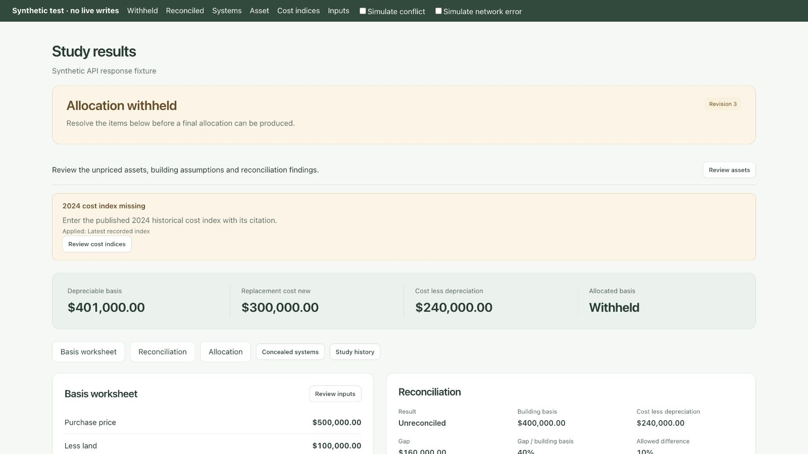

# Live Results workspace verification

Verified locally on October 30–31, 2026. This is frontend verification, not a backend deployment, financial validation, or client-report approval.

## Scope and baseline

The active checkout is the existing `codex/vision-review-workbench` worktree. Existing room, photo, appraisal and navigation changes were preserved. Port 3100 serves its `web/` directory. Backend implementation was read from merged main at `7aa78c3`; the running API on port 8000 still has the older result contract and no cost-index endpoints. The API/worker stack and live studies were not restarted or changed.

The previous Results screen summed priced replacement costs and labeled them allocated cost. It now renders the server's worksheet, recorded allocation and reconciliation independently. Unknown amounts remain unknown. Missing allocation, missing reconciliation and failed checks have explicit states.

## Automated checks

`node --test web/tests/*.test.cjs`: **244 passed, 0 failed**.

Syntax checks passed for result-view, live-results, intake-view, error-help, live-app and live-review. `git diff --check` passed.

Coverage added for:

- Withheld, reconciled and legacy result responses; failed checks; zero versus unknown amounts; server-provided totals and source links.
- Concealed model inputs, sources and assumptions; asset cost equations and classification/ruling provenance; escaped source text and before/after data.
- Allocation CSV quoting and spreadsheet-formula escaping; no CSV action for withheld allocation.
- All 221 catalogue entries, unknown errors, and deduplicated review codes that are not positional matches to raw reasons.
- Failed-stage priority over stale gate data; stalled versus failed behavior; role checks; retry key reuse after an uncertain request and renewal after an acknowledged request.
- Cost-index precision, year/date, citation, region and conversion validation; API paths and idempotency keys.
- Intake request field whitelist and decimal strings; viewer/engineer spend-screen guards; unavailable endpoints and settings routing.

## Browser checks against the running API

Read-only navigation in the in-app browser verified:

- Study progress links to Results, inputs, history and owner-facing spend.
- Results displays the legacy reconciliation warning, recorded basis/RCN/allocation, worksheet checks, recovery-class amounts, unpriced assets and missing systems. A recorded allocation with a failed uniform-factor check is not labeled reconciled.
- Asset review displays the actual quantity, adjusted unit cost and total with cents, verbatim RSMeans row/page/year/location source text, error-code guidance, classification method, original citations and photo evidence.
- History displays stage and review-wait durations, recorded events and engineer decisions. Unknown historical data is not invented.
- Spend displays recorded totals and stage/model/service groups. Loading another page adds provider calls successfully.
- Cost indices explains that the connected server needs newer endpoints instead of showing a broken or fabricated index list.
- Study inputs populates stored values. Native select chevrons were initially hidden by a more specific shared style; the selector was corrected and the final layout was rechecked visually.
- No JavaScript console errors were captured on the final Results navigation.

No live intake edits, cost-index writes, approvals, retries or paid provider runs were submitted.

## Synthetic browser checks for the current API contract

`web/tests/fixtures/results.html` uses the real renderer/controllers and synthetic API responses. It never calls the live API. Verified withheld and reconciled results, model class/type/source/assumptions, concealed costs, and firm-ruling disagreement with before/after details.

The cost-index form retains entries on a simulated network failure and completes a synthetic save after recovery. The intake form blocks a simulated concurrent change before submission, retains the draft, then completes a synthetic save when the conflict is removed.

`results-mobile.html` embeds the same fixture at 390px wide. Screenshots confirmed stacked sections and readable controls. Horizontal gestures revealed the remaining table columns; a vertical gesture while over the table moved the surrounding page. This is a narrow-layout check, not a physical-device touch test.

## Remaining integration limits

- Current model/reconciliation/index screens need the newer API deployed locally before they can be verified against real current-contract responses. Form persistence was tested with synthetic responses, not live database writes.
- The API still omits structured base unit cost and separate historical index objects. The UI preserves the recorded source string and does not reverse-engineer a base price from rounded costs.
- Adding an index does not reprice existing assets; updating intake does not rebuild quantities, classification or stored costs. A reviewed rebuild action needs a backend contract.
- Spend is owner-only in the UI; the backend currently permits viewers. API authorization must be tightened if owner-only is the product policy.
- Intake conflict detection is GET-before-PUT and is not atomic. Version/ETag support is required for race-safe updates.
- Inventory-row deletion, missing appraisal-field creation, model confirmation and the final client PDF remain backend/report work. JSON and CSV are explicitly named downloads.

The copyable backend prompt is in [CLAUDE_HANDOFF.md](CLAUDE_HANDOFF.md). Private live-study screenshots and values were kept outside this repository.

## Design references

Used native expandable sections consistent with the [WAI disclosure pattern](https://www.w3.org/WAI/ARIA/apg/patterns/disclosure/), visible actionable errors informed by [GOV.UK error summaries](https://design-system.service.gov.uk/components/error-summary/), and paired facts informed by the [GOV.UK summary list](https://design-system.service.gov.uk/components/summary-list/). The existing approved Basis palette, buttons and page-flow scrolling were retained.
